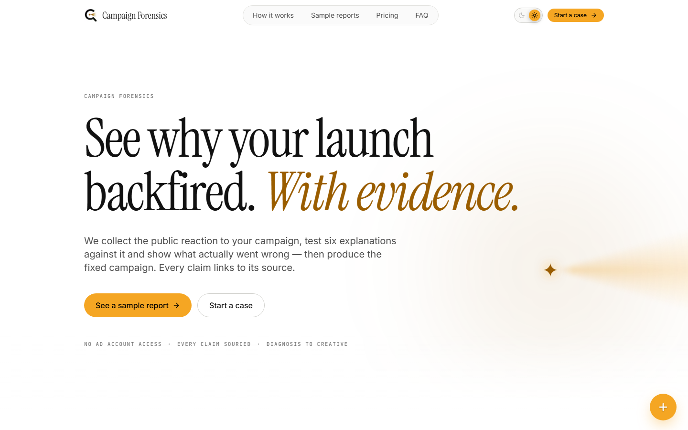
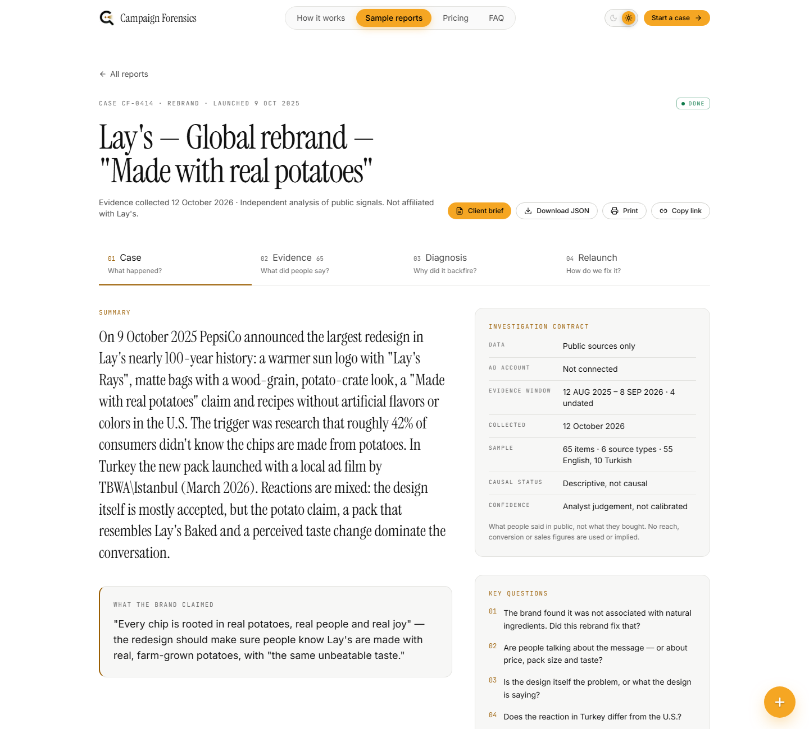
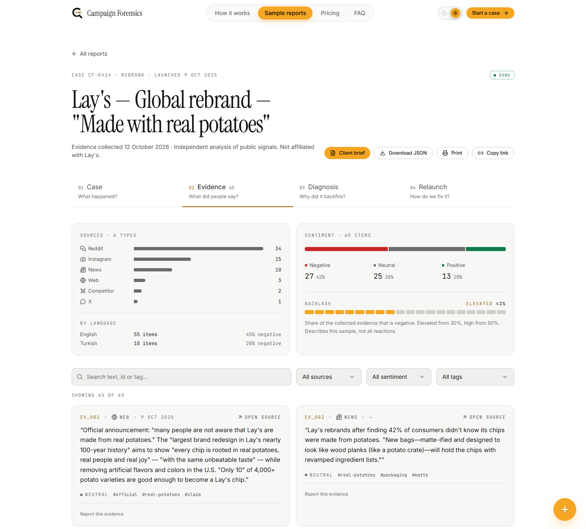
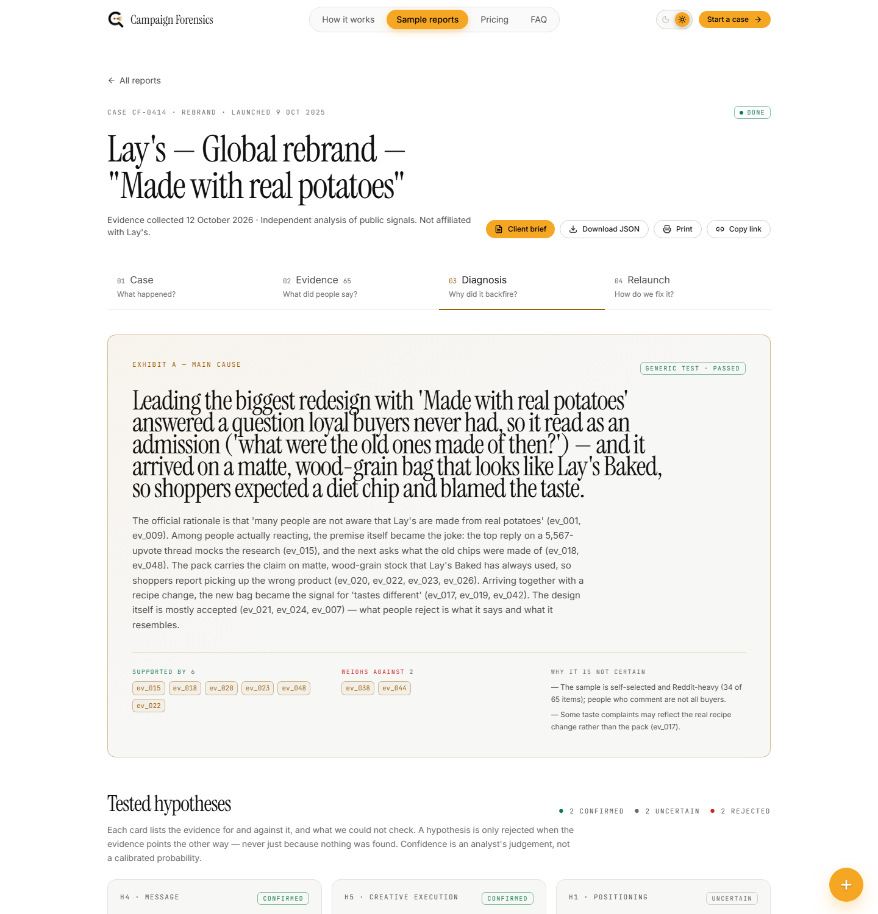
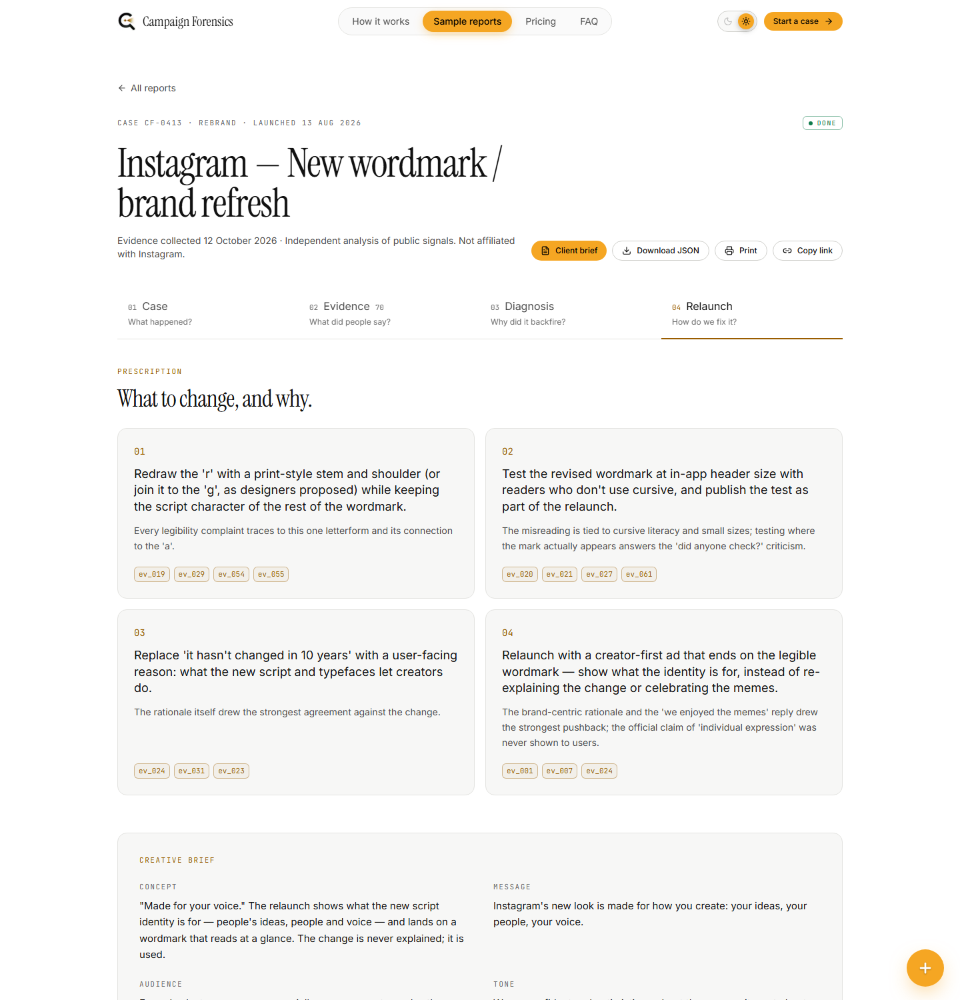
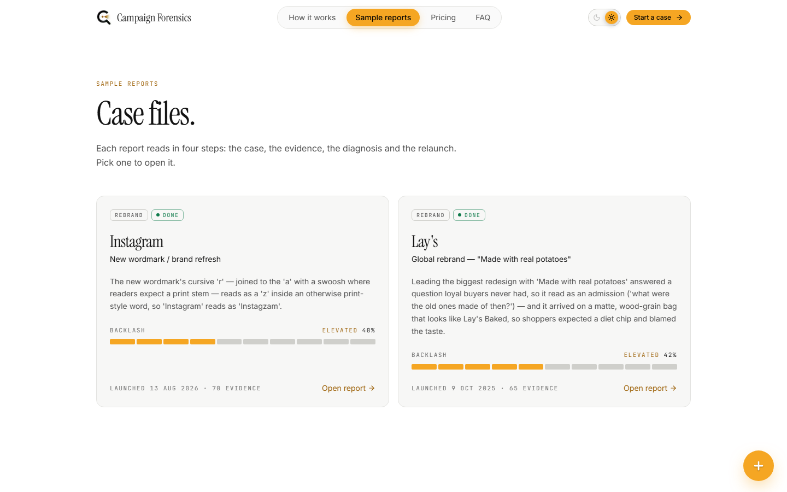
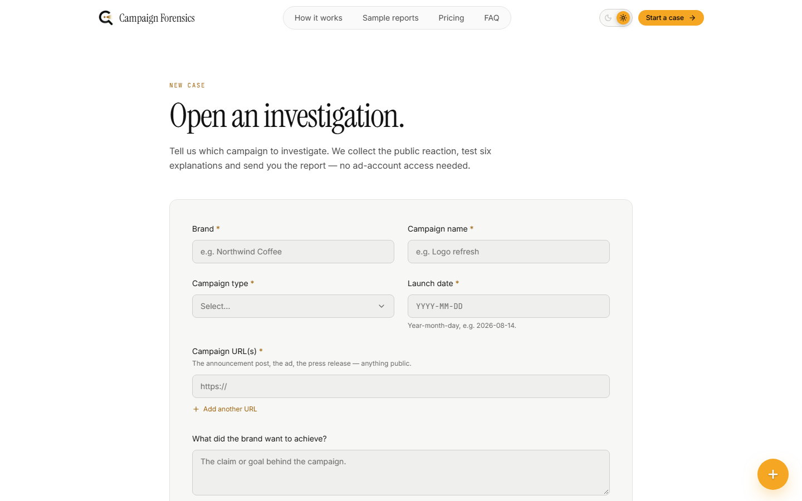
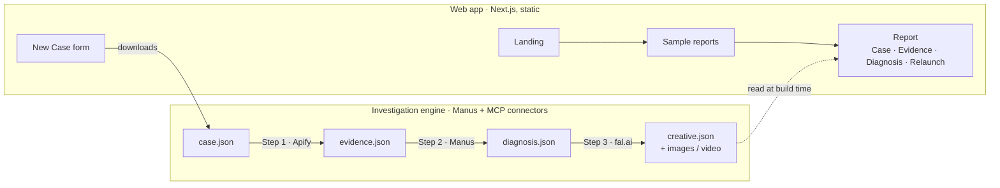

<div align="center">

<picture>
  <source media="(prefers-color-scheme: dark)" srcset="docs/brand/logo-dark.png" />
  
</picture>

# Campaign Forensics

### See why your launch backfired. *With evidence.*

Campaign diagnosis for agencies and brand teams: collect the public reaction to a campaign,<br />
test six explanations against it, name what actually went wrong — and produce the fixed campaign.


[Quick start](#quick-start) · [Report tour](#a-tour-of-a-report) · [Sample cases](#sample-cases) · [Architecture](#how-its-built) · [Design](#design)

<sub>Built for the <b>10X Your Brand Hackathon</b> · Istanbul · 12 October 2026</sub>

</div>

<picture>
  <source media="(prefers-color-scheme: dark)" srcset="docs/screenshots/dark/landing.png" />
  
</picture>

## Why it's different

| 🔒 No ad-account access | 🔗 Every claim is sourced | 🎬 Diagnosis to creative |
|---|---|---|
| Works from public signals only — news, social comments, video, forums and competitor campaigns. | Each conclusion links to the evidence behind it. Hypotheses that don't hold up are shown as rejected, not hidden. | The fix isn't a slide of recommendations: it's a brief plus a produced concept image and relaunch video. |

## Quick start

Runs entirely on your machine — no hosting, no accounts, no database. You need **Node.js 18.18+**.

```bash
git clone https://github.com/Goktugelbir/campaign-forensics.git
cd campaign-forensics
npm install
npm run local
```

Open **http://localhost:3000**. Every script serves on port **3000**, so that is always the address.

- `npm run local` builds and serves the fast production build — use it for demos.
- `npm run dev` reloads on every save while you edit code.
- Stop either with `Ctrl + C`. If port 3000 is taken, stop whatever is using it first.

> **Offline:** `npm install` and the first build need internet (packages and fonts are bundled). After that,
> `npm start` serves the last build with no connection; only the "Open source" links on evidence cards go online.

## A tour of a report

Every report reads in **four steps**: numbered tabs that stay visible while you scroll, each ending with a
**Next step** button. The tab and the evidence card live in the URL, so links are shareable —
e.g. `/cases/lays-rebrand?tab=evidence#ev_015`.

| Step | Answers | What you see |
|---|---|---|
| **01 Case** | *What happened?* | What launched, what the brand claimed, and the questions the investigation set out to answer. |
| **02 Evidence** | *What did people say?* | Public reactions with source and sentiment charts, filters and search. Every card links to its source; no usernames. |
| **03 Diagnosis** | *Why did it backfire?* | The main cause, six tested hypotheses (confirmed → uncertain → rejected), a surprising finding and contributing causes. |
| **04 Relaunch** | *How do we fix it?* | Prescription, creative brief, the generated concept and video, and a before / after table. |

<table>
  <tr>
    <td width="50%">
      <b>01 Case</b> — the brief, in one screen<br /><br />
      <picture>
        <source media="(prefers-color-scheme: dark)" srcset="docs/screenshots/dark/report-case.png" />
        
      </picture>
    </td>
    <td width="50%">
      <b>02 Evidence</b> — 65 sourced items for Lay's, filterable by source, sentiment and tag<br /><br />
      <picture>
        <source media="(prefers-color-scheme: dark)" srcset="docs/screenshots/dark/report-evidence.png" />
        
      </picture>
    </td>
  </tr>
  <tr>
    <td width="50%">
      <b>03 Diagnosis</b> — click any <code>ev_015</code>-style ID to jump to that evidence card<br /><br />
      <picture>
        <source media="(prefers-color-scheme: dark)" srcset="docs/screenshots/dark/report-diagnosis.png" />
        
      </picture>
    </td>
    <td width="50%">
      <b>04 Relaunch</b> — what to change, why, and the produced creative<br /><br />
      <picture>
        <source media="(prefers-color-scheme: dark)" srcset="docs/screenshots/dark/report-relaunch.png" />
        
      </picture>
    </td>
  </tr>
</table>

<details>
<summary><b>More screens</b> — sample reports list · New Case form</summary>
<br />

<picture>
  <source media="(prefers-color-scheme: dark)" srcset="docs/screenshots/dark/cases.png" />
  
</picture>

<picture>
  <source media="(prefers-color-scheme: dark)" srcset="docs/screenshots/dark/new-case.png" />
  
</picture>

</details>

### The evidence chain

Every conclusion can be followed back to what people actually said — and every limit is stated.

- **Evidence ledger** (`forensics.json`) — each hypothesis lists the evidence that **supports** it, the evidence
  **against** it, background **context** and the **missing data** we could not check. A hypothesis is only rejected when
  evidence points the other way, never because nothing was found.
- **Investigation contract** (Case tab) — public sources only · no ad account · evidence window · sample size and
  languages · *descriptive, not causal* · confidence is an analyst judgement, *not calibrated*.
- **Investigation log** (Case tab) — rebuilt from `raw/`: every Apify actor with its run IDs and limits (including runs
  that returned nothing) and every fal.ai generation with time, model and duration.
- **Why this changed** (Relaunch tab) — each produced asset names the prescription items it answers and their evidence.
- **Quality gate** (Relaunch tab) — an automated preflight (real file type, 16:9 frame, 10–20 s video, lineage, AI
  label, no performance claims), then a separate **human review** recorded in `approval.json`. Nothing is shown as
  approved unless someone did.
- **Client brief** (`/cases/<slug>/deliver`) — one printable page an agency can hand over.
- **English only** — non-English evidence is shown as a labelled AI translation; the original stays in `evidence.json`.

<details>
<summary><b>Scoring and navigation details</b></summary>
<br />

Scores use level indicators in the style of AppKit's `NSLevelIndicator` (SwiftUI `Gauge`)
([`components/LevelIndicator.tsx`](components/LevelIndicator.tsx)):

| Score | Style | Meaning |
|---|---|---|
| **Backlash** — case cards and the Evidence tab | discrete capacity, warning 30, critical 50 | Share of the collected evidence that is negative: green low, amber elevated (≥ 30%), red high (≥ 50%). Lay's 42%, Instagram 40%. |
| **Confidence** — every hypothesis | relevancy | How strongly the evidence supports that hypothesis, 0–100. |

There is no star rating: the evidence carries no ratings, and the app never invents data.

- **Header:** How it works · Sample reports · Pricing · FAQ, a sliding **light / dark switch** and **Start a case**.
- **Floating button** (bottom-right): the amber **+** opens *Start a case*, *Sample reports* and *Contact us*; a
  back-to-top button joins it after 400 px of scrolling. `Esc` closes the menu.

</details>

## Sample cases

Both are real investigations run on 12 October 2026: evidence collected with the Apify MCP connector, the diagnosis
written by Manus, the creative generated with fal.ai.

| Case | Evidence | Sources | Main cause, in short |
|---|:---:|---|---|
| [**Lay's — Global rebrand**](data/cases/lays-rebrand) · *featured* | 65 | news, web, Reddit, Instagram, X, competitor | Leading with *"Made with real potatoes"* read as an admission, on a bag that looks like Lay's Baked. |
| [**Instagram — New wordmark**](data/cases/instagram-wordmark-2026) | 70 | news, web, Reddit, YouTube, Instagram, competitor | The cursive *r* reads as a *z*, so "Instagram" reads as "Instagzam". |

Each case folder holds `case.json → evidence.json → diagnosis.json → creative.json`, plus `raw/` with the actor output
(usernames removed) and every fal.ai request log.

## How it's built

Two layers. The web app never calls Apify or fal.ai — it only reads the JSON files the engine wrote.



| | |
|---|---|
| **Framework** | Next.js 15 (App Router) · React 19 · TypeScript |
| **Styling** | Tailwind CSS with theme tokens as CSS variables · `lucide-react` icons |
| **Data** | JSON files in `data/cases/<slug>/` — no database, no auth, no payments |
| **Tests** | Vitest + Testing Library |
| **Engine** | Manus agent · Apify MCP · fal.ai (`ideogram/v3`, `kling-video/v3`, `elevenlabs/tts`, `lyria2`) |

### Scripts

| Script | What it does |
|---|---|
| `npm run local` | Build + serve on http://localhost:3000 (recommended) |
| `npm run dev` | Dev server with live reload on http://localhost:3000 |
| `npm run build` / `npm start` | Build only / serve the last build on port 3000 |
| `npm test` | Unit, component and data-contract tests |
| `npm run typecheck` | TypeScript, including tests |
| `npm run validate:case [slug]` | Checks a case end to end and runs the creative preflight; writes `preflight.json` (Node 22.6+) |
| `npm run check:links [url]` | Crawls a running server from `/` and fails on any broken internal link |
| `npm run screenshots [url]` | Regenerates `docs/screenshots/{light,dark}/` from a running server (Chrome/Edge, Node 22+; set `CHROME_PATH` if needed) |

<details>
<summary><b>Project structure</b></summary>

```
campaign-forensics/
├── app/                      # routes (App Router)
│   ├── page.tsx              # landing
│   ├── cases/                # /cases list · /cases/[slug] report · /deliver client brief · /print
│   ├── new/                  # New Case form → "Investigation queued" + case.json download
│   ├── how-it-works/ pricing/ faq/ about/ contact/
│   ├── legal/[page]/         # one LegalPage template for all 7 legal pages
│   └── icon.png              # favicon (generated from the logo)
├── components/
│   ├── report/               # ReportView, the four tabs, steps.ts (step names + questions)
│   └── ...                   # header, footer, cards, badges, forms, theme switch
├── content/                  # FAQ, pricing, legal markdown (all English)
├── data/cases/<slug>/        # case · evidence · diagnosis · creative JSON, optional forensics / preflight / approval (+ raw/)
├── lib/                      # types.ts (data contracts), data loading, formatting, site switches
├── prompts/                  # versioned fal.ai prompts and video edit recipes per case
├── public/
│   ├── brand/                # logo mark
│   └── cases/<slug>/         # the images and video shown in each report
├── scripts/                  # fal-generate, compose-video, check-links, screenshots
├── tests/                    # Vitest suites (+ data/test-case, a fictional case used as a fixture)
└── docs/                     # README logo and screenshots
```

| Route | Page |
|---|---|
| `/` | Landing — hero over the beam background, the four report steps, sample reports, start a case |
| `/cases` | Sample reports |
| `/cases/[slug]` | Report — tab in the URL: `?tab=evidence#ev_014` |
| `/cases/[slug]/deliver` | Client brief — one printable page that answers six questions |
| `/cases/[slug]/print` | All four steps on one page; browser "Save as PDF" exports it |
| `/new` | New Case form → "Investigation queued" + downloadable `case.json` draft |
| `/how-it-works` · `/pricing` · `/faq` · `/about` · `/contact` | Product & company |
| `/legal/[page]` | privacy · gdpr · cookies · terms · data-sources · disclaimer · data-request |

</details>

## Data and contracts

All shapes live in [`lib/types.ts`](lib/types.ts), and `tests/data.test.ts` validates **every** case folder against
them: exactly 6 hypotheses, ≥ 2 known evidence IDs each, no usernames or profile links, `sources_summary` matching the
evidence, every local media file present, and no API keys in `creative.json`. Run `npm test` after each engine step.

**Optional sidecars** hold relations and checks only — never new evidence, URLs or claims — and a missing one leaves the
report working: `forensics.json` (evidence ledger), `preflight.json` (written by `npm run validate:case`) and
`approval.json` (written by a person after review). `validate:case` fails on an unknown evidence ID, an item classified
twice, a rejection without counter-evidence, a performance term (winner, ROAS, CPA, CTR, conversion, lift) in a
public-only case, a missing or mislabelled asset, or an approval while the preflight failed.

Case pages are pre-rendered from the folders present at build time — **rebuild after adding a case** (unknown slugs
return a real 404). A missing step file shows that tab as "in progress"; corrupt JSON goes to the error screen.

**Switches** in [`lib/site.ts`](lib/site.ts):

- `FEATURED_CASE_SLUG` — the case behind the landing preview and "See a sample report" (now `lays-rebrand`).
- `HERO_MEDIA` — the landing background. `null` (default) is the animated amber beam; to use your own footage, put it in
  `public/hero/` and set `{ video: "/hero/hero.mp4", poster: "/hero/hero.jpg" }` or `{ image: "/hero/hero.jpg" }`.
- `SITE.contactEmail` is a placeholder on the reserved `.example` domain; `TEAM` fills the `/about` page.

## Running the investigation engine

The engine runs as a Manus task:

| Command | Does |
|---|---|
| `Run step 1 for <slug>` | Evidence via Apify — shows the source plan first; `maxItems` 50–100 per call, 30–80 items total |
| `Run step 2 for <slug>` | Diagnosis, including the generic-diagnosis test |
| `Run step 3 for <slug>` | Creative via fal.ai using [`prompts/fal_from_brief.md`](prompts/fal_from_brief.md) — 1 image first, max 2 video attempts |
| `Run full investigation for <slug>` | All three, with a short summary between steps |

Generating a single creative asset by hand:

```bash
cp .env.example .env.local      # then set FAL_KEY
node scripts/fal-generate.mjs <slug> <name> <fal-model-id> prompts/<slug>/<name>.json
```

It uploads local `start_image_url` files, downloads the result to `public/cases/<slug>/` immediately (fal URLs expire)
and logs model, request ID and input to `data/cases/<slug>/raw/fal-<name>.json`. Models verified on fal.ai on
2026-10-12: `fal-ai/ideogram/v3` ($0.06 per image) and `fal-ai/kling-video/v3/standard/image-to-video` (audio off, $0.084/s).

`scripts/compose-video.mjs prompts/<slug>/edit.json` cuts the final video from clips, voice-over and music. Only the
finished videos are kept in the repo, so re-cutting one means generating its source clips again first.

> `FAL_KEY` lives only in the engine's environment. It is never committed and never shipped to the browser.

## Design

A "digital forensic case file" in two themes. **Dark is the default**; the header switch flips to light, the choice is
remembered in the browser (`cf-theme` in local storage, disclosed on the Cookie Policy) and applied before the first
paint, so it never flashes.

| Token | Dark | Light |
|---|---|---|
| Page | `#000000` | `#ffffff` |
| Cards | `#0e0e0e`, 1px `#222` border | `#f7f7f6`, 1px `#e3e3e0` border |
| Text | `#ffffff` headings · `#9a9a9a` body | `#111111` headings · `#4a4a4a` body |
| Accent | amber `#f5a623` | amber fills `#f5a623` · amber text `#9a5d00` (5.3:1) |

Instrument Serif headings, Inter body, JetBrains Mono labels. Colours are CSS variables in
[`app/globals.css`](app/globals.css), mapped to Tailwind in [`tailwind.config.ts`](tailwind.config.ts). Animations
respect `prefers-reduced-motion`. Brand names appear as plain text; no third-party logos.

## Responsible use

Campaign Forensics analyses **public** signals only. Usernames, profile photos and profile links never enter a report —
comments are stored as anonymous text and link to the post, not the person. Every report states that it is independent
and not affiliated with the brand, and generated creative is labelled *"Concept based on diagnosis — not an official
design."* See [`content/legal/data-sources.md`](content/legal/data-sources.md) and
[`content/legal/disclaimer.md`](content/legal/disclaimer.md).

## Team

| | |
|---|---|
| **Mehmet Göktuğ Elbir** | Product & strategy |
| **Mehmet Burak Albayrak** | Engineering & data |
| **Fatih Kadim** | Creative & brand |

---

<div align="center">
<sub>© 2026 Campaign Forensics · Brand names are trademarks of their owners. We are not affiliated with any brand we analyze.</sub>
</div>
